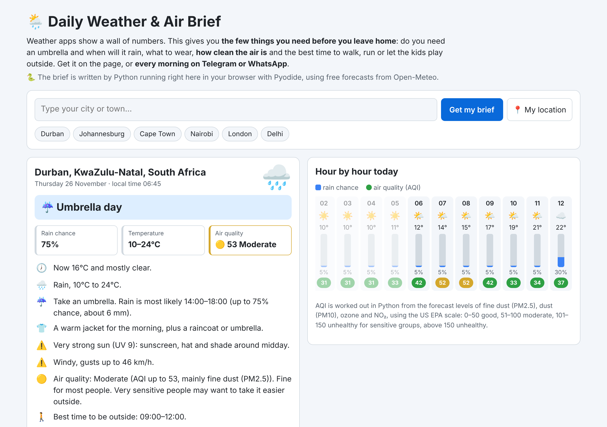

# 🌦️ Daily Weather & Air Brief

**Live demo:** https://knarf24.github.io/weather-brief/

Weather apps show a wall of numbers. This gives you the few things you need before you leave home:

- ☔ **Umbrella or not**, and *when* the rain is most likely (e.g. "14:00–18:00, up to 75%")
- 👕 **What to wear**, plus warnings for strong sun, wind and heat
- 🟢 **How clean the air is**: the Air Quality Index worked out in Python from the forecast pollutant levels, the main pollutant, and what to do about it
- 🚶 **The best time to be outside** today (dry, cleanest air, not the hottest hours)
- 📅 A one-line look at tomorrow
- 📲 **Every morning on Telegram or WhatsApp**, free, through GitHub Actions

Written in **Python**. The web page runs the same `brief.py` in your browser with [Pyodide](https://pyodide.org), so there is no server.
Forecasts come from [Open-Meteo](https://open-meteo.com) (free, no API key).



## Built from three GeeksforGeeks projects

| GeeksforGeeks project | What it became here |
|---|---|
| [Scraping Weather Data for an Umbrella Reminder](https://www.geeksforgeeks.org/python/scraping-weather-data-using-python-to-get-umbrella-reminder-on-email/) | Hourly rain chance from Open-Meteo, umbrella decision and rain window |
| [Predicting Air Quality Index](https://www.geeksforgeeks.org/python/predicting-air-quality-index-using-python/) | AQI computed from PM2.5, PM10, ozone and NO₂ forecasts with the US EPA breakpoint formula |
| [Automate WhatsApp Messages](https://www.geeksforgeeks.org/python/automate-whatsapp-messages-with-python-using-pywhatkit-module/) | A daily scheduled message to WhatsApp (CallMeBot) or Telegram, no computer left on |

## Get the brief every morning

1. Fork or copy this repository.
2. Pick where it should go and add the secrets under **Settings → Secrets and variables → Actions → Secrets**:
   - **Telegram:** message `@BotFather`, send `/newbot`, copy the token into `TELEGRAM_BOT_TOKEN`. Send your bot any message, open
     `https://api.telegram.org/bot<token>/getUpdates` and copy the number after `"chat":{"id":` into `TELEGRAM_CHAT_ID`.
   - **WhatsApp (CallMeBot, free for messages to yourself):** save `+34 694 29 84 96` in your contacts and send it
     `I allow callmebot to send me messages`. Put your number (like `+27821234567`) in `CALLMEBOT_PHONE` and the key it sends back in `CALLMEBOT_APIKEY`.
3. Under **Variables**, add `CITY` (for example `Johannesburg`). Without it the brief is for Durban.
4. Open **Actions → Morning brief → Run workflow** to try it now. After that it runs every day at 04:30 UTC (06:30 in South Africa);
   change the time in [`.github/workflows/morning-brief.yml`](.github/workflows/morning-brief.yml).

GitHub pauses scheduled jobs in repositories with no activity for 60 days; re-enable it on the Actions tab if that happens.

## Run it on your computer

Python 3.10+ and nothing to install:

```bash
python send_brief.py "Cape Town"          # print the brief
python send_brief.py "Cape Town" --send   # and send it (uses the same environment variables as above)
```

## Files

| File | What it does |
|---|---|
| `brief.py` | Everything: finding the place, fetching the forecast, AQI maths, writing the brief |
| `send_brief.py` | Command line and the morning job: prints the brief and sends it to Telegram / WhatsApp |
| `web/` | The page (HTML, CSS, a little JavaScript) and Pyodide |
| `tests/` | `python -m pytest -q` (no internet needed) and a browser test (`sh build_site.sh && node tests/browser_test.js`) |

## Data and privacy

Weather and air-quality data by [Open-Meteo.com](https://open-meteo.com/) under CC BY 4.0; air quality from CAMS (Copernicus).
The page saves only your recent cities, in your own browser. Forecasts can be wrong: for severe weather follow your national weather service.

MIT License.
